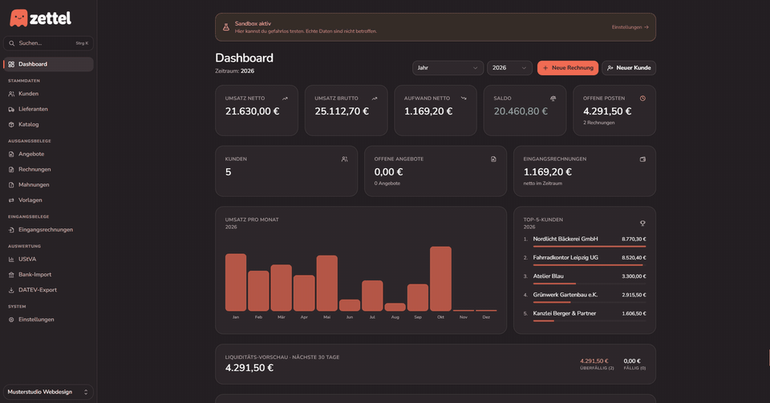
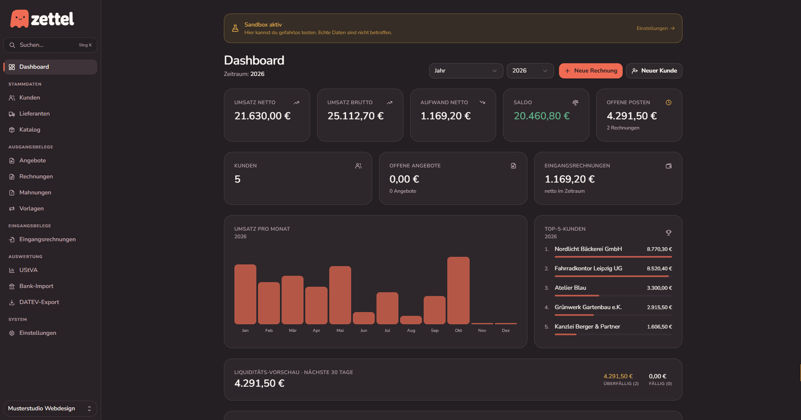
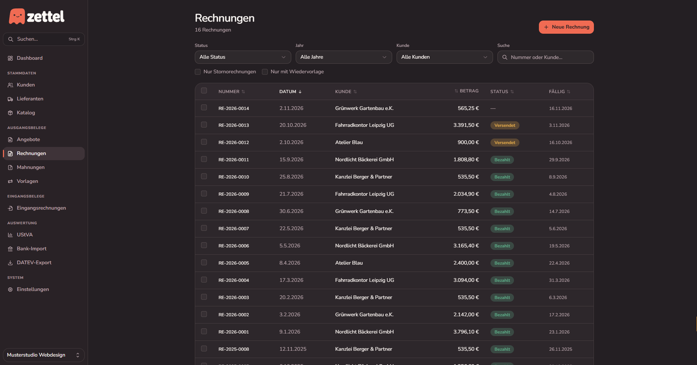
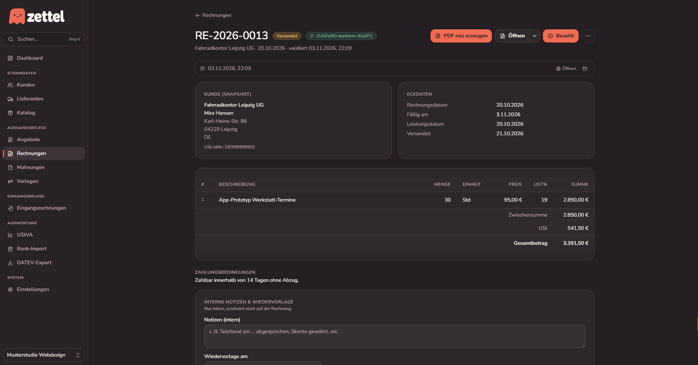
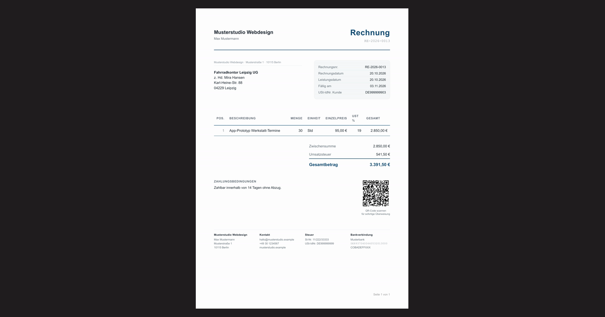
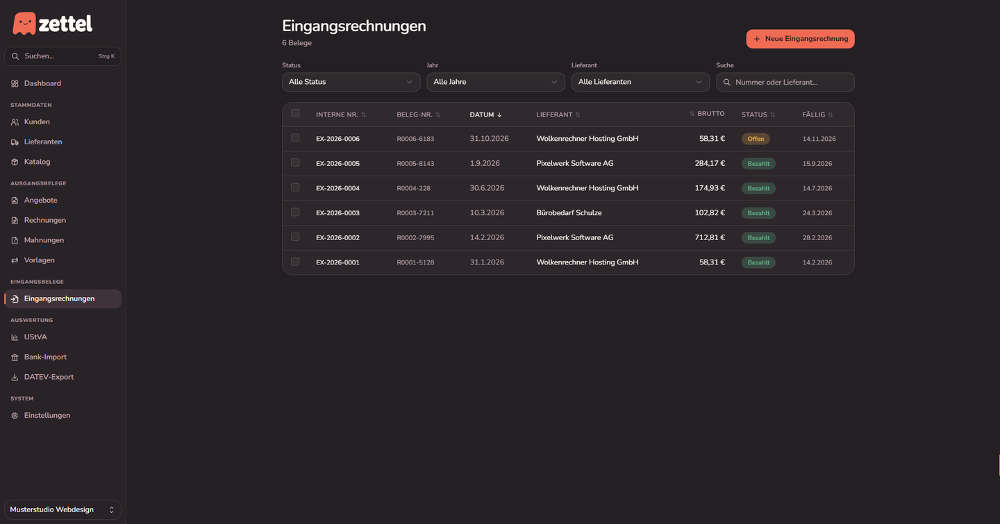
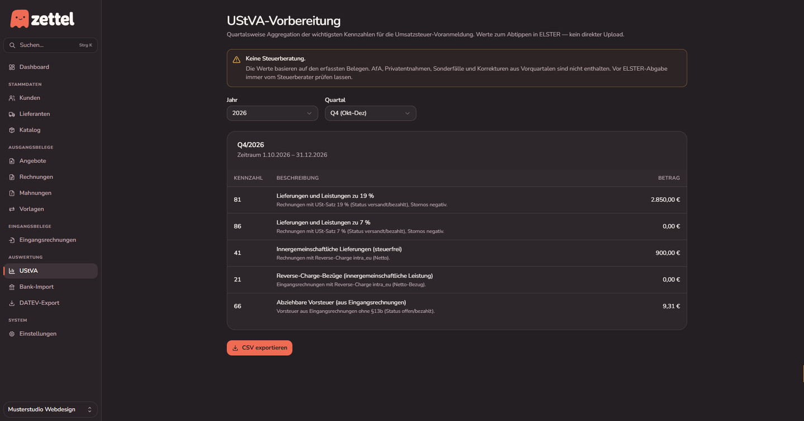

<div align="center">

<picture>
  <source media="(prefers-color-scheme: dark)" srcset="./branding/buerofreund/banners/readme-banner-dark.png">
  
</picture>

# Zettel

**Offline-first Rechnungen für deutsche Freelancer und Kleinunternehmer.**
ZUGFeRD- / Factur-X-konforme PDF/A-3 mit eingebettetem EN-16931-XML und XRechnung-Export — lokal, ohne Cloud, ohne Abo.

[](https://github.com/jonax1337/zettel/releases)
[](https://github.com/jonax1337/zettel/actions/workflows/build.yml)
[](./LICENSE)
[](https://github.com/jonax1337/zettel/stargazers)

[](https://tauri.app)
[](https://svelte.dev)
[](https://www.typescriptlang.org)
[](https://tailwindcss.com)
[](https://python.org)
[](https://github.com/itplr-kosit/validator)
[](https://xeinkauf.de/xrechnung/)
[](https://sqlite.org)

[Download](https://github.com/jonax1337/zettel/releases/latest) · [Diskutieren](https://github.com/jonax1337/zettel/discussions) · [Changelog](./CHANGELOG.md) · [Mitmachen](./CONTRIBUTING.md) · [Security](./SECURITY.md) · [Design Kit](./branding/buerofreund/README.md)

</div>

<br />

## Screenshots

<!--
  Bilder leben unter `docs/screenshots/` — siehe `docs/screenshots/README.md` für Konventionen.
  Alle Aufnahmen stammen aus dem Sandbox-Modus mit fiktiven Daten (Musterstudio Webdesign).
-->

<p align="center">
  
</p>

<table>
  <tr>
    <td align="center"><a href="./docs/screenshots/dashboard.png"></a><br /><sub>Dashboard</sub></td>
    <td align="center"><a href="./docs/screenshots/invoices.png"></a><br /><sub>Rechnungen</sub></td>
  </tr>
  <tr>
    <td align="center"><a href="./docs/screenshots/invoice-validated.png"></a><br /><sub>KoSIT-geprüft</sub></td>
    <td align="center"><a href="./docs/screenshots/pdf-preview.png"></a><br /><sub>PDF/A-3 + ZUGFeRD</sub></td>
  </tr>
  <tr>
    <td align="center"><a href="./docs/screenshots/expenses.png"></a><br /><sub>Eingangsrechnungen</sub></td>
    <td align="center"><a href="./docs/screenshots/ustva.png"></a><br /><sub>UStVA-Vorbereitung</sub></td>
  </tr>
</table>

## Warum Zettel?

Ich bin Solo-Selbstständig und hatte keine Lust auf weitere 20–30 € pro Monat für SaaS-Buchhaltung, nur um ein paar Rechnungen pro Quartal zu schreiben. Erst recht nicht, wenn meine Buchhaltungs-Daten dann irgendwo in einem AWS-Bucket eines deutschen GmbH-mit-niederländischer-Holding-Konstrukts liegen.

Zettel ist das, was dabei rausgekommen ist: ein kleines Desktop-Tool, das **lokal** läuft, die **deutsche E-Rechnungs-Norm EN 16931** korrekt umsetzt, den **Kleinunternehmer-Modus (§ 19 UStG)** als First-Class-Feature behandelt — und keine Telemetrie sendet, weil es keinen Server gibt, an den es senden könnte.

|  | SaaS-Tools | Zettel |
|---|---|---|
| Hosting | Cloud (DSGVO-AVV nötig) | Dein Rechner |
| Kosten | 15–40 €/Monat | Einmalig 0 € |
| Daten-Eigentum | Vendor-Lockin | SQLite-File auf deiner Disk |
| ZUGFeRD-XML | Häufig nur ab Premium | Standard, alle Profile |
| Funktioniert offline | Selten | Immer |
| Internet weg → kein Backup? | Problem | Egal |

## Features

### Rechnungen, die EN 16931 wirklich erfüllen
- PDF/A-3 mit eingebettetem **Factur-X-XML** in den Profilen **BASIC**, **EN 16931** und **EXTENDED**
- **Kleinunternehmer-Modus** mit korrektem `CategoryCode E` und BR-CO-26-konformem `BT-29`-Fallback ohne USt-IdNr.
- **Reverse-Charge** intra-EU (CategoryCode K) und Drittland (CategoryCode G) inkl. Pflicht-Hinweistexte
- **Stornorechnungen** als first-class Credit-Notes mit korrektem CII-Schema
- **XRechnung 3.0 (CII)** als eigene `.xml` für öffentliche Auftraggeber, mit **Leitweg-ID** am Kunden (als Käuferreferenz in die Rechnung übernommen) und Pflichtangaben-Prüfung vor dem Export; auch per CLI (`invoice:xrechnung`)
- **E-Rechnung prüfen** (Sidebar „E-Rechnung validieren“): eingebauter KoSIT-Validator — erzeugte und eingehende Rechnungen (PDF oder XML) direkt in der App gegen die offiziellen XRechnung-Scenarios prüfen, mit Fundstellen-genauem Report (gebundelte JRE, kein System-Java nötig)
- **Per E-Mail senden:** Rechnung, Angebot oder Mahnung wird samt PDF an dein Mail-Programm übergeben (Mail-Vorlagen in den Einstellungen); versendet wird dort, Zettel selbst baut keine Verbindung auf
- **IBAN-Prüfung:** IBANs werden normalisiert, in Vierergruppen angezeigt und bei ungültiger Prüfsumme markiert
- Mehrere USt-Sätze pro Rechnung (0 %, 7 %, 19 %), Multi-Currency mit eingefrorenem EUR-Wert
- Drei PDF-Themes (classic / modern / minimal) per CSS-Variablen
- **PDF auf Deutsch oder Englisch** pro Rechnung wählbar (XML bleibt sprach-neutral nach Norm)
- **Leistungszeiträume** (BG-14 / BG-26) auf Header- und Positions-Ebene, lange Positions-Beschreibungen (BT-154)
- **Artikel-/Leistungs-Katalog** für wiederverwendbare Positionen (DE + EN-Beschreibungen)
- **Skonto** (Frühzahler-Rabatt) strukturiert als `ApplicableTradePaymentDiscountTerms` im XML
- **EPC-QR-Code (Girocode)** automatisch auf EUR-Rechnungen mit IBAN — Empfänger scannt mit Banking-App
- **Angebote** als eigener Dokumententyp mit One-Click-Konvertierung zur Rechnung

### Buchhaltungs-Light
- **Eingangsrechnungen** mit Drop-Zone für ZUGFeRD-PDFs (automatisches Parsing) und OCR-Light-Fallback (Text-Layer-Extraktion, kein Tesseract)
- **Lieferanten-Verwaltung** mit USt-IdNr.-Matching beim Drop
- **Kuratierte Ausgaben-Kategorien** mit SKR03- und SKR04-Konten-Mapping (Software, Hardware, Reise, …)
- **Teilzahlungen** mit eigener Tabelle und automatischem `partial`-Status für teil-bezahlte Rechnungen
- **Bank-Import** für CAMT.053 (XML) und MT940 (Text) mit Auto-Match auf Rechnungsnummer / Betrag / Kunde
- **DATEV-Export** (Format 700, SKR03/SKR04) — Erlöse, Aufwände und Stornos in einem Buchungsstapel
- **UStVA-Vorbereitung** (Kennzahlen 81/86/41/21/66 pro Quartal, zum Abtippen)
- **Anlage EÜR** nach Zahlungsdatum, sortiert nach den Zeilen des amtlichen Vordrucks (Formular 2025/2026), zum Abtippen in ELSTER; Export als CSV
- **Zeiterfassung** mit Projekten je Kunde, Timer oder Handeingabe und Abrechnung der Zeiten als Rechnungsentwurf
- **Mahnungen** als eigene Dokumentenklasse mit Nummernkreis `MA-…`, Eskalations-Strip pro Rechnung
- **Bulk-Aktionen** in Rechnungen-, Angebote- und Eingangsrechnungen-Listen

### Steuer-Rücklage
- § 32a EStG-Tarif für **VZ 2024, 2025 und 2026** hartcodiert aus amtlicher BMF-Bekanntmachung, 38 Testfälle
- Splittingtarif für Verheiratete, Soli mit Milderungszone, KiSt 8/9 %, GewSt mit § 35-Anrechnung
- Pauschal-Modus (% × Umsatz) als zusätzliche Sanity-Check-Anzeige
- YTD-Modus vs. Hochrechnung; Quartals-Vorauszahlungen werden gegengerechnet
- Nebenberuf: marginale ESt-Berechnung wenn `other_income_annual_cent` gesetzt ist

### Dashboard & Workflow
- Zeitraum-Switcher (Jahr / Quartal / Monat / Custom) mit YoY-Kontext
- **Globale Suche** (`Cmd/Ctrl+K`) über alle Entities inkl. Item-Beschreibungen
- **Liquiditäts-Vorschau** über die nächsten 30 Tage (offene Posten + überfällige + wiederkehrend)
- **Wiedervorlage**-Liste pro Kunde/Rechnung mit `follow_up_date`
- **Onboarding-Wizard** beim ersten Start, sortierbare Tabellen in allen Listen
- Interne Notizen (nicht auf der PDF)
- **Wiederkehrende Rechnungen** (monatlich / quartalsweise / jährlich) — explizit per Klick erzeugen, kein stilles Background-Cron

### Daten gehören dir
- **GoBD-Unterstützung:** unveränderliches **Änderungsprotokoll** (Datenbank-Trigger, alte und neue Werte), **Rechnungssiegel** als SHA-256-Hash-Kette und **Integritätsprüfung** unter Einstellungen → Daten; Rechnungen mit Nummer lassen sich nur per Stornorechnung korrigieren. Keine Zertifizierung und keine qualifizierte Signatur — Grenzen in [`COMPLIANCE.md`](./COMPLIANCE.md), Vorlage in [`docs/verfahrensdokumentation.md`](./docs/verfahrensdokumentation.md)
- **Backup** als verschlüsseltes ZIP (AES-256-GCM + Argon2id) oder unverschlüsselt
- **Auto-Backup** mit konfigurierbarem Intervall (rotierender Wochen-Snapshot)
- **Granularer Restore** (Kunden / Rechnungen+PDFs / Settings unabhängig)
- **Sandbox-Modus** mit separater DB zum Ausprobieren
- **Mandanten:** mehrere getrennte Datenbanken, wählbar unten links in der Sidebar
- **Auto-Update** Ed25519-signiert via GitHub Releases, wahlweise im stabilen Kanal oder im **Beta-Kanal** (Release Candidates)
- **Danger Zone** mit Auto-Backup vor jeder destruktiven Aktion

## Install

Vorgebaute Installer für Windows, macOS und Linux: [latest release](https://github.com/jonax1337/zettel/releases/latest).

| Plattform | Format | Hinweis |
|---|---|---|
| Windows 10/11 | `.msi`, `.exe` (NSIS) | Beim ersten Start: SmartScreen → *Weitere Informationen → Trotzdem ausführen* |
| macOS (Apple Silicon) | `.dmg` | Nicht notarisiert — Rechtsklick → *Öffnen*. Intel-Build pausiert (CI-Capacity) |
| Linux (Ubuntu 22.04+) | `.deb` | System-Pango/Cairo nötig (siehe unten) |

**Linux / macOS Systempakete** (WeasyPrint lädt Pango und Cairo dynamisch):

```bash
# Ubuntu / Debian
sudo apt install libpango1.0-0 libcairo2 libgdk-pixbuf2.0-0

# macOS
brew install pango cairo gdk-pixbuf
```

Auto-Update ist ab v0.4.3 aktiv. Ältere Installationen einmal manuell auf die aktuelle Version ziehen. Die Prüfung läuft automatisch kurz nach dem Start; in den Einstellungen wählst du zwischen stabilem Kanal und Beta-Kanal (Release Candidates). Details: [`PRIVACY.md`](./PRIVACY.md).

## Quickstart

Beim ersten Start führt der **Onboarding-Wizard** durch Firma, Steuer, Bank. Schließt du ihn einfach, erscheint er beim nächsten Start wieder, solange kein Firmenname gespeichert ist; „Nicht mehr anzeigen“ blendet ihn dauerhaft aus. Wer manuell loslegen will:

1. **Einstellungen → Unternehmen** öffnen, Firmendaten + Steuernummer (bzw. USt-IdNr.) eintragen
2. **Einstellungen → Steuerprofil** ausfüllen, damit das Dashboard die Steuer-Rücklage berechnen kann
3. **Kunde** anlegen (`/customers/new`)
4. **Neue Rechnung** → Kunde wählen → Positionen → speichern
5. **PDF erzeugen** → `<Dokumente>/Zettel/Rechnungen/RE-2026-0001.pdf` (`<Dokumente>` ist der Ordner „Dokumente“ deines Betriebssystems; Sandbox und eigene Mandanten haben eigene Unterordner, siehe [`PRIVACY.md`](./PRIVACY.md))

Für eingehende Rechnungen: `/expenses` öffnen, PDF in die Drop-Zone ziehen — ZUGFeRD-XML wird automatisch geparsed, Vendor via USt-IdNr. gematcht.

## Was Zettel nicht ist

Bewusst ausgeschlossen — diese Dinge sind im Scope anderer Tools besser aufgehoben:

- **Keine vollständige Buchhaltung** (kein doppelter Eintrag, kein Konten-Plan, kein Jahresabschluss)
- **Keine Online-Banking-Anbindung** — der Bank-Import liest CAMT.053-/MT940-Dateien lokal ein, keine Live-Verbindung zur Bank
- **Kein ELSTER-Upload** und kein UStVA-Versand — Zettel bereitet vor, du tippst ab oder gibst es dem Steuerberater
- **Keine Cloud, kein Sync, keine Mobile-App** — bewusst nicht in Scope
- **Kein SMTP** — Zettel übergibt die Rechnung samt PDF an dein Mail-Programm, versendet wird dort
- **Kein Tesseract-OCR** — gescannte Belege funktionieren nicht und sollen es auch nicht
- **Keine Telemetrie** — es gibt buchstäblich keinen Server, der was empfangen könnte

## Architektur

Vier Laufzeiten, sternförmig orchestriert über Rust — Frontend, Python und Java reden nie direkt miteinander:

```
┌─────────────────────────────────────────────────────────────┐
│  Frontend  Svelte 5 (runes) · Tailwind v4 · Bits UI         │
│            svelte-spa-router (hash)                         │
└──────────────────────────┬──────────────────────────────────┘
                           │ Tauri Commands (invoke, IPC)
┌──────────────────────────┴──────────────────────────────────┐
│  Rust       Tauri 2 · plugin-sql · Updater · ureq           │
│             AES-256-GCM Backup · Sandbox · Mandanten        │
│             ECB-Kurs · Mail-Übergabe                        │
└────┬─────────────────┬─────────────────────────┬────────────┘
     │ SQLite          │ spawn(stdio JSON)        │ spawn(CLI)
     ▼                 ▼                          ▼
┌──────────┐  ┌───────────────────┐  ┌───────────────────────┐
│ zettel.db│  │  Python Sidecar   │  │  Java (gebundelte JRE) │
│ (SQLite) │  │  WeasyPrint       │  │  KoSIT-Validator       │
└──────────┘  │  factur-x · lxml  │  │  XRechnung-Scenarios   │
              │  pypdf            │  └───────────────────────┘
              └───────────────────┘
```

- **Frontend** (`src/`) — Svelte 5 mit Runes, hash-Routing via `svelte-spa-router`, UI als shadcn-Style-Wrapper über Bits UI in `src/lib/ui/`. Ruft Rust über Tauri-`invoke()` auf
- **Persistenz** (`src/lib/db/`) — SQLite direkt via `@tauri-apps/plugin-sql`. Schema-Typen aus Drizzle (nur compile-time), Queries als raw parameterized SQL. Migrations werden compile-time via `include_str!` in den Rust-Layer eingebettet
- **Rust** (`src-tauri/src/`) — der zentrale Orchestrator: Tauri-Commands, Backup, Crypto, Sandbox und Mandanten, ECB-Wechselkurs, Mail-Übergabe (`mail.rs`), Updater (`updates.rs`), Sidecar-Bridge (`sidecar.rs`) und Validator-Bridge (`validator.rs`)
- **Python-Sidecar** (`sidecar/`) — JSON-RPC über stdin/stdout. Rust spawnt pro Aufruf einen frischen Prozess. PDF-Rendering via WeasyPrint + Jinja2, ZUGFeRD-XML via `factur-x`, eingehende PDFs via `factur-x.extract` oder `pypdf`-Heuristik. PyInstaller-gebundelt im Release-Build
- **Java-Validator** (`tools/kosit-validator`, `tools/jre`) — der offizielle [KoSIT-Validator](https://github.com/itplr-kosit/validator) (`validator.jar`) prüft erzeugte und eingehende E-Rechnungen gegen die XRechnung-Scenarios. Rust extrahiert dazu erst die XML über den Sidecar und startet dann Java als CLI-Subprozess (`java -jar validator.jar …`). Eine per `jlink` minimierte JRE (~35 MB) wird mitgebundelt — **kein System-Java nötig**. Nur im Release-Build aktiv (bzw. in dev mit lokalem `tools/jre` + `tools/kosit-validator`)

Implementierungs-Details und Konventionen: [`CLAUDE.md`](./CLAUDE.md). DATEV-Mapping: [`docs/datev-export.md`](./docs/datev-export.md).

## Build from source

```bash
git clone https://github.com/jonax1337/zettel
cd zettel
pnpm install

# Sidecar-Venv für dev
cd sidecar
python -m venv .venv
# Windows:
.\.venv\Scripts\Activate.ps1
# macOS / Linux:
source .venv/bin/activate
pip install -r requirements.txt
cd ..

pnpm tauri:dev
```

**Release-Build** (mit gebundeltem Sidecar, KoSIT-Validator und JRE):

```bash
tools/download-validator.sh   # KoSIT validator.jar + XRechnung-Scenarios
tools/build-jre.sh            # per jlink minimierte JRE nach tools/jre/
pnpm tauri:build              # baut vorher den Sidecar neu (scripts/build-sidecar.mjs)
```

Vollständige Plattform-Voraussetzungen (GTK3-Runtime auf Windows, Tauri-System-Deps, Python 3.12) und Konventionen: [`CONTRIBUTING.md`](./CONTRIBUTING.md).

## Roadmap

Geplant — siehe [Issues](https://github.com/jonax1337/zettel/issues) und [Discussions](https://github.com/jonax1337/zettel/discussions). Größere Themen, die in Diskussion sind:

- Englische UI (PDF auf Englisch existiert seit v0.16, die App-UI ist noch nur Deutsch)
- AfA / Anlageverzeichnis (die Anlage EÜR enthält AfA und Anlagevermögen bislang nicht)
- Eigene Ausgaben-Kategorien in den Settings anlegen und verwalten (Schema steht; in den Einstellungen lässt sich bisher nur die Anlage-EÜR-Zeile je Kategorie wählen)

Was bereits drin ist: [`CHANGELOG.md`](./CHANGELOG.md).

## Mitmachen

Issues, Patches und Vorschläge sind willkommen. Setup, Konventionen und PR-Workflow in [`CONTRIBUTING.md`](./CONTRIBUTING.md). Code of Conduct in [`CODE_OF_CONDUCT.md`](./CODE_OF_CONDUCT.md).

Gute Einstiegspunkte: Issues mit Label [`good first issue`](https://github.com/jonax1337/zettel/issues?q=is%3Aopen+label%3A%22good+first+issue%22) und [`help wanted`](https://github.com/jonax1337/zettel/issues?q=is%3Aopen+label%3A%22help+wanted%22).

## Sicherheit, Datenschutz, Compliance

- **Schwachstelle melden:** [`SECURITY.md`](./SECURITY.md) — bitte keine öffentlichen Issues für Security-Bugs
- **Was wird gespeichert, was geht raus:** [`PRIVACY.md`](./PRIVACY.md) — keine Telemetrie, alle Daten lokal
- **GoBD, § 14 UStG, Aufbewahrung, Verfahrensdokumentation:** [`COMPLIANCE.md`](./COMPLIANCE.md)

## Disclaimer

Zettel ist keine Rechts- oder Steuerberatung. Die erzeugten Rechnungen sind nach bestem Wissen EN-16931-konform, aber **ohne Garantie**. Die ersten Rechnungen vor dem Versand vom Steuerberater prüfen lassen. Die Steuer-Rücklage-Berechnung ist eine Vorhersage, kein Steuerbescheid — Quartals-Vorauszahlungen, individuelle Sonderausgaben und außergewöhnliche Belastungen werden nicht berücksichtigt. UStVA und Anlage EÜR bereiten Werte zum Abtippen in ELSTER vor (ohne AfA, Anlagevermögen und Sonderfälle) und ersetzen weder die Steuererklärung noch den Steuerberater. Details zu den Grenzen (insbesondere GoBD, Änderungsprotokoll, E-Rechnungspflicht, Aufbewahrungsfristen): [`COMPLIANCE.md`](./COMPLIANCE.md).

## Lizenz

[MIT](./LICENSE) — © Jonas Laux & Contributors

Lizenzen der verwendeten Open-Source-Komponenten: [`THIRD_PARTY_LICENSES.md`](./THIRD_PARTY_LICENSES.md).

## Acknowledgments

Dieses Projekt würde ohne diese tollen Open-Source-Tools nicht existieren: [Tauri](https://tauri.app), [Svelte](https://svelte.dev), [WeasyPrint](https://weasyprint.org), [factur-x](https://github.com/akretion/factur-x), [Bits UI](https://www.bits-ui.com) und die Schriften [Nunito](https://github.com/googlefonts/nunito). Die Icons sind eigene Bürofreund-Icons. Validierung über [erechnungs-validator.de](https://erechnungs-validator.de) und den [KoSIT-Validator](https://github.com/itplr-kosit/validator).
