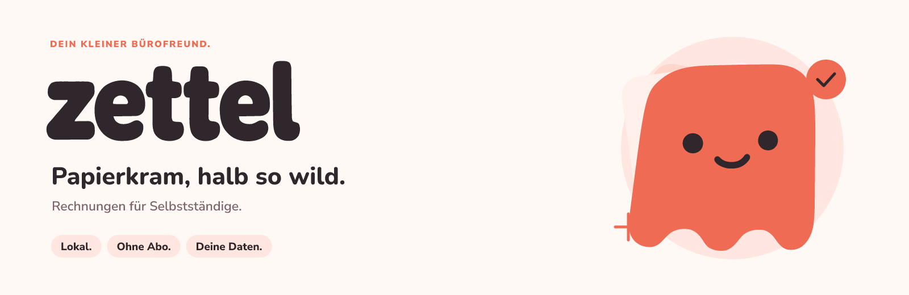

# Zettel · Bürofreund Design Kit

Das vollständige Branding zur ausgewählten Richtung **Bürofreund**: ein sympathischer Beleg als Begleiter durch den Papierkram.

<picture>
  <source media="(prefers-color-scheme: dark)" srcset="banners/readme-banner-dark.png">
  
</picture>

[Asset-Galerie öffnen](index.html) · [Gestaltungsregeln](GUIDELINES.md) · [Originalvergleich](reference/comparison.png) · [Alle Dateien](asset-manifest.json)

## Enthalten

| Bereich | Inhalt |
| --- | --- |
| Logo | Horizontale und gestapelte Varianten: Farbe, für dunkle Flächen, einfarbig dunkel, einfarbig hell und Koralle |
| Wortmarke | Eigene Buchstabenformen aus dem ausgewählten Entwurf, als Pfade in Dunkel, Hell und Koralle |
| Maskottchen | Farbe, inverse Farbe, einfarbig, Kontur und sechs Gesichtsausdrücke |
| App und Browser | Drei App-Icon-Farbvarianten, PNG-Größen von 16 bis 1024 px, maskierbares Icon, Favicon, ICO, ICNS, Apple-Touch-Icon und Webmanifest |
| Repository | README-Banner in Hell und Dunkel, jeweils SVG, PNG und PNG in doppelter Auflösung |
| Social Media | GitHub Social Preview, Open Graph, quadratischer Beitrag, Avatar und Profil-Cover, jeweils Hell und Dunkel |
| Illustrationen | Willkommen, leere Rechnungsliste, keine Suchergebnisse, Erfolg, Backup und Fehler |
| System | 82 App-Icons mit passenden Svelte-Komponenten, zwölf zusätzliche UI-Motive, Belegmuster und zwei Desktop-Hintergründe in 4K |
| Vorlagen | Dokumentkopf, E-Mail-Signatur, Markenkarte und Stickerbogen |
| Grundlagen | Markenübersicht, Schriftdateien mit Lizenz, Farbpalette, CSS- und JSON-Tokens, SVG-Master und Referenzvergleich |

## Schnellzugriff

- [Primäres Logo als SVG](logos/horizontal-primary.svg) · [transparentes PNG](logos/horizontal-primary.png)
- [Maskottchen als SVG](mascot/mascot-primary.svg) · [transparentes PNG](mascot/mascot-primary.png)
- [README-Banner hell](banners/readme-banner-light.png) · [dunkel](banners/readme-banner-dark.png)
- [GitHub Social Preview, 1280 × 640](social/github-social-light.png)
- [Design-Kit auf einen Blick](brand-overview.png)
- [Alle 82 App-Icons auf einen Blick](ui-icons/app-icons-overview.png)
- [Gestaltungsregeln](GUIDELINES.md)

## Verwendung

Die SVG-Dateien sind die skalierbaren, bearbeitbaren Originale. Logo und Wortmarke bestehen aus Pfaden und benötigen beim Anzeigen keine installierten Schriften. Die PNGs haben bei Logos und Maskottchen einen transparenten Hintergrund.

Die Wortmarke wurde direkt aus dem ausgewählten Konzept vektorisiert. **Nunito ist die Begleitschrift für Überschriften, kein Ersatz für die Wortmarke.** Nunito Sans ist für Fließtext und Oberflächen vorgesehen.

In `source/` liegen die Masterdateien, die Konturen und ein Referenzvergleich. Das ausgewählte Konzeptbild liegt in `reference/`. Der Vergleich trennt die erste, verworfene Vektorversion von den korrigierten Dateien.

Alle Asset-SVGs enthalten echte Vektoren. Nur die ausdrücklich als Vergleich gekennzeichnete Datei `reference/comparison.svg` enthält Rasterbilder, damit die Originalvorlage sichtbar bleibt.

## Schriften

Die Originaldateien von Nunito und Nunito Sans einschließlich der jeweiligen SIL-OFL-Lizenz liegen in `fonts/`. Herkunft: [Nunito](https://github.com/google/fonts/tree/main/ofl/nunito) und [Nunito Sans](https://github.com/google/fonts/tree/main/ofl/nunitosans).

Für die Grafikdateien gelten die [Lizenzbedingungen des Repositorys](LICENSE); die beigefügten Schriften haben ihre eigenen Lizenzen. Die Bildvorlage wurde für Zettel generiert und die ausgewählte Richtung anschließend als konsistentes Vektorsystem ausgearbeitet.

## Icons in der App austauschen

Die 82 Icons entsprechen den Importnamen aus den 46 verwendenden App-Dateien. Die vollständige Zuordnung steht in [ui-icons/app-icon-inventory.json](ui-icons/app-icon-inventory.json). Das austauschbare Svelte-Paket liegt im Repository unter [src/lib/brand-icons](../../src/lib/brand-icons/README.md) und als Kopie in [svelte/](svelte/README.md).

Für die Umstellung wird die Importquelle von `@lucide/svelte` auf `$lib/brand-icons` geändert. Namen wie `FileText`, `Plus`, `Calendar as CalendarIcon` und `Settings as SettingsIcon` bleiben gleich. Größe, Farbe, Strichstärke, CSS-Klassen, SVG- und ARIA-Attribute werden übernommen. Die vorhandenen App-Imports wurden für dieses vorbereitende Paket nicht verändert.
